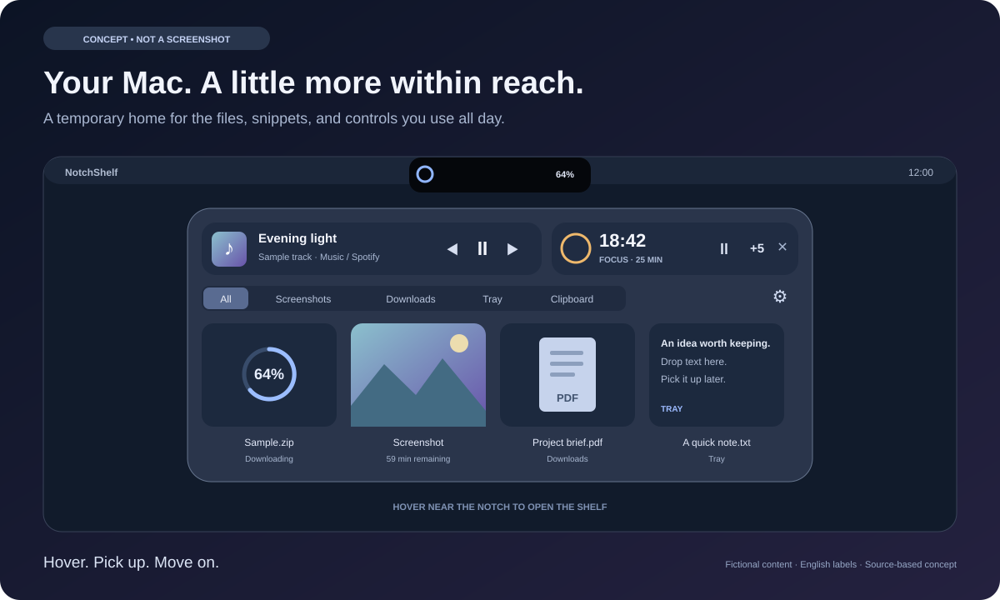
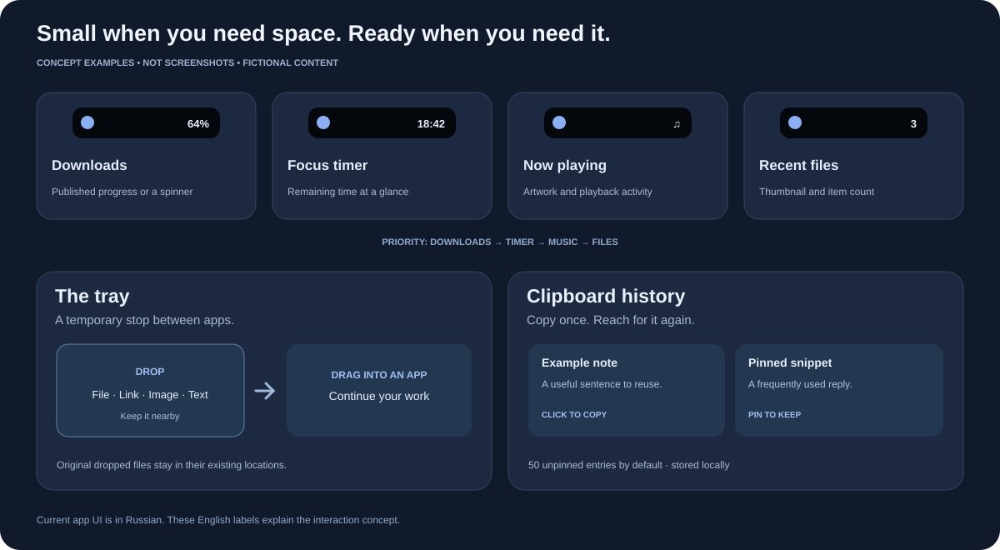

<div align="center">

# NotchShelf

**A small shelf at the top of your Mac.**

Keep screenshots, downloads, copied snippets, music, and a focus timer one hover away.

[](https://github.com/henadzibahdanovich/NotchShelf/actions/workflows/build.yml)
[](LICENSE)




*Concept illustration based on the source code, with fictional content and English labels. Not a screenshot. The current app interface is in Russian.*

</div>

## What is a macOS notch shelf?

NotchShelf turns the space around your MacBook's camera notch into a temporary shelf for things you use throughout the day. Hover near the notch to open a panel, pick up a recent file, drop something into the tray, or copy an earlier clipboard entry. On a display without a notch, the code provides a small pill at the top center instead.

It runs as a menu bar app, without a Dock icon. The shelf is a working area for recent items; file cleanup behavior depends on the item type and your settings.

## Features

| Feature | Implemented behavior |
| --- | --- |
| **Screenshots and downloads** | Watches the configured screenshot folder and Downloads, shows thumbnails, and lets you drag files into other apps. Screenshot actions include copying, pinning, opening, and local text recognition through Apple Vision. |
| **Music and Spotify** | Track title, artist, artwork, previous/next, and play/pause. AppleScript provides the Music/Spotify fallback; an optional private MediaRemote bridge attempts system-wide playback access. |
| **Download progress** | A ring near the notch and a card in the panel. Uses system-published file progress when available; recognized temporary download files show an indeterminate indicator otherwise. |
| **Focus timer** | 5, 15, 25, and 50 minute presets, pause/resume, add five minutes, and stop. Completion plays a sound and reveals the shelf. |
| **Clipboard history** | Text and images, click to copy, drag out, pin, and delete. Keeps 50 unpinned entries by default; settings offer 20/50/100/200. Pinned entries do not count toward that limit. |
| **Drag-and-drop tray** | Accepts files, URLs, images, and text. Existing files stay in place and are referenced by the tray; dropped text, links, and images are saved in the app's local support folder. |

The collapsed indicator prioritizes **downloads → timer → playing music → recent files**.



*Concept examples only. The download percentage, timer, filenames, and clipboard content are fictional.*

## Project status

This is an early personal utility, published with its source code. It is not a validated production release.

- **Local release compilation passed on November 12, 2026:** Apple Silicon (`arm64`), macOS 26.6.2, Apple Swift 6.3.3.
- The previously reported actor-isolation error in `ClipboardHistory.swift` did not recur in that build. The directory accessor is declared `nonisolated` in this source.
- Local `--build-only` packaging, app metadata validation, and ad-hoc signature verification also passed. The badge above reports GitHub Actions status, not runtime compatibility.
- Music/Spotify automation, clipboard capture, drag-and-drop, download reporting, login items, and multi-display behavior have **not been verified end to end** as part of publication.
- There is no automated runtime test suite, signed/notarized release, or prebuilt download in this initial publication. Intel and older supported macOS versions remain unverified.

## Requirements

- macOS **14 or newer**, as declared by the package and app bundle.
- Apple's Command Line Tools or Xcode with a compatible Swift compiler and macOS SDK. `Package.swift` uses Swift tools version 5.9. The verified toolchain is listed above; the minimum toolchain has not been independently tested.
- A notch is optional. The shelf chooses one screen, preferring a notched display.
- Liquid Glass is used when compiled with Swift 6.2+ and a macOS 26 SDK, and run on macOS 26+. Earlier systems/toolchains use the material fallback in the source.

No third-party Swift packages, account, backend, or API key are required.

## Install from source

1. If developer tools are not installed, run `xcode-select --install` and finish the installation.
2. Clone and build:

   ```bash
   git clone https://github.com/henadzibahdanovich/NotchShelf.git
   cd NotchShelf
   ./install.sh
   ```

The script builds for your Mac's current architecture, packages `build/NotchShelf.app`, applies a local ad-hoc signature, installs it in `/Applications`, and launches it. If replacing an existing app, it keeps a backup under `build/previous-install.*`. Do not run the script with `sudo`; if `/Applications` is not writable, move the built app there with Finder.

To compile and package **without installing or launching**:

```bash
./install.sh --build-only
```

For compilation alone:

```bash
swift build -c release
```

Ad-hoc signing is not Developer ID signing or Apple notarization. The installer does not remove quarantine attributes or disable Gatekeeper. If macOS blocks a downloaded build, review the source and use the normal macOS security controls; no security-bypass command is included.

If signing reports “resource fork, Finder information, or similar detritus not allowed” in an iCloud or other synced folder, move the checkout to a local folder outside that service and rebuild. Publication validation passed from a clean local checkout; the synced Documents folder added metadata during packaging.

## First launch, permissions, and cleanup

**Review Settings before using the shelf with files you want to keep.** These are the current defaults in the source:

| Setting or action | Current behavior |
| --- | --- |
| Screenshot location | The initial migration sets the system screenshot folder to **Downloads** and saves the previous location for uninstall. Settings also offer Desktop or `~/Pictures/NotchShelf`. |
| System screenshot thumbnail | Disabled on first launch to make files appear sooner. This changes the macOS screenshot setting, not just NotchShelf. |
| Screenshot expiration | Unpinned screenshots are sent to the **Trash after 60 minutes** by default. Select Never to disable expiry. |
| Screenshot drag-out | After an accepted drag, unpinned screenshots are sent to the Trash after a 15-second delay by default. This is a separate setting from expiration. |
| Clearing the shelf | Unpinned screenshots go to the Trash. Downloads are removed from the shelf unless their delete setting is enabled. App-created tray files are deleted when dismissed. |
| Downloads | Removed from the shelf after 24 hours by default; original downloaded files stay on disk. Optional settings can send them to the Trash. |
| Tray | Original dropped files are not moved. App-created text/link/image files are deleted on dismissal, or 15 seconds after accepted drag-out when that option is enabled. |
| Clipboard | History is enabled by default and stored locally. Turning it off stops new capture; it does not erase existing entries. |

macOS may request **Files and Folders** access for watched folders and **Automation** access to control Music or Spotify. Grant access only to features you want to use. You can review these in System Settings → Privacy & Security. Launch at login is optional and uses the system login-item service.

The app watches screenshots saved by macOS; it does not implement its own screen recording. The source does not request broad Full Disk Access or Accessibility access. Music integration depends on the running player's permissions.

## Privacy and local storage

- Clipboard text and metadata are stored as JSON, and clipboard images as PNGs, under `~/Library/Application Support/NotchShelf/Clips/`. These files are **not encrypted by the app**.
- Dropped text, links, and images are stored under `~/Library/Application Support/NotchShelf/Tray/`. Shelf references and settings are kept in UserDefaults.
- Known concealed/transient pasteboard markers are skipped. **This is not a guarantee that all passwords or secrets are excluded**: unmarked sensitive text can be captured. Pause history before copying sensitive content and remove saved entries as needed.
- The reviewed source contains no analytics or cloud-sync implementation. Spotify artwork can be fetched over the network from the artwork URL returned by Spotify.
- No personal clipboard data, screenshots, `.env` files, certificates, developer caches, or compiled app bundle are included in this repository.

## Limitations

- The app's current menus and settings are in **Russian**. README illustrations use English labels to explain the concept; they do not represent an English localization.
- Browser playback, including YouTube, is not guaranteed. MediaRemote is a private framework and may be unavailable or change without notice. Music and Spotify use the explicit AppleScript fallback.
- Percentage progress depends on what the browser or downloader publishes to macOS. Temporary-file detection is heuristic; not every download is visible.
- Watching is limited to configured top-level folders. Existing untracked files are not imported automatically, and screenshot identification relies on macOS metadata.
- The timer is in memory and is not restored after quitting. It is not a system alarm service.
- The shelf currently targets one display. Full-screen, multi-monitor, notchless, and Intel behavior need further testing.
- There is no custom global keyboard shortcut, AI assistant integration, cloud upload, image conversion, or GIF generation in this source.

## Uninstall

Disable “Open at login” in Settings if enabled, quit NotchShelf, then run:

```bash
./uninstall.sh
```

The script removes the installed app, restores the saved screenshot location if one is available, re-enables the system screenshot thumbnail, and deletes the app's preferences. It leaves clipboard/tray data and screenshot files on disk. After quitting, you can remove `~/Library/Application Support/NotchShelf/` yourself if you want to erase that local history. Review any tray files you want to keep first.

The original bundle identifier, `app.glamlabs.notchshelf`, is retained for compatibility with existing preferences and permissions. The repository is maintained under the personal account linked above.

## Development and contributions

The project uses Swift Package Manager with AppKit, SwiftUI, Vision, and Quick Look. Open `Package.swift` in Xcode or build from the command line.

- `Sources/NotchShelf/`: app lifecycle, shelf UI, filesystem monitoring, clipboard, playback, and timer.
- `Resources/AppIcon.icns`: the supplied app icon.
- `install.sh` / `uninstall.sh`: local packaging and installation lifecycle.
- `docs/images/`: labeled concept illustrations, not application screenshots.

See [CONTRIBUTING.md](CONTRIBUTING.md) for validation and issue-reporting guidance. Please keep personal files and clipboard contents out of issues and pull requests.

## License

[MIT](LICENSE) · Copyright (c) 2026 Henadzi Bahdanovich.
