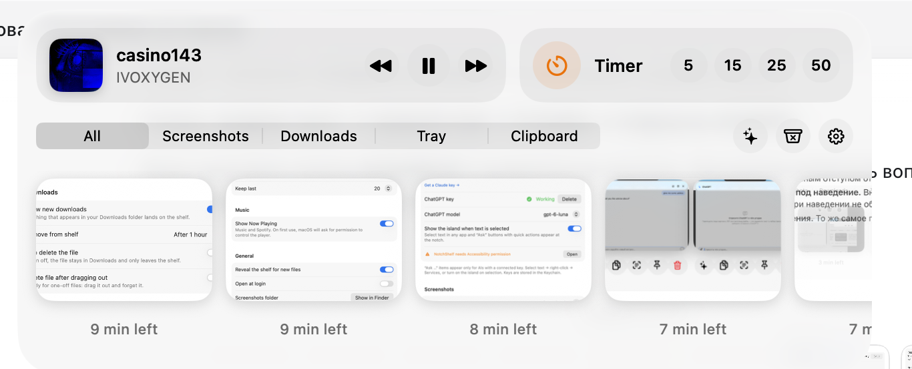
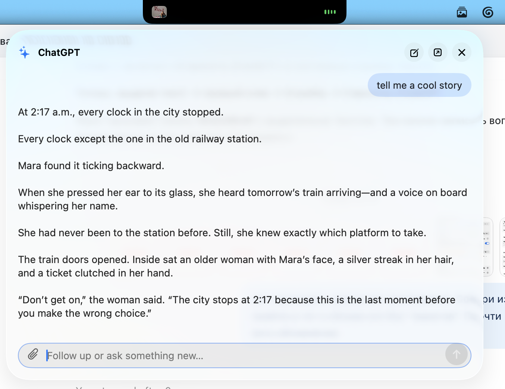
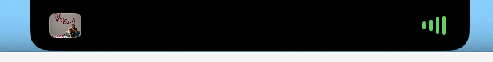
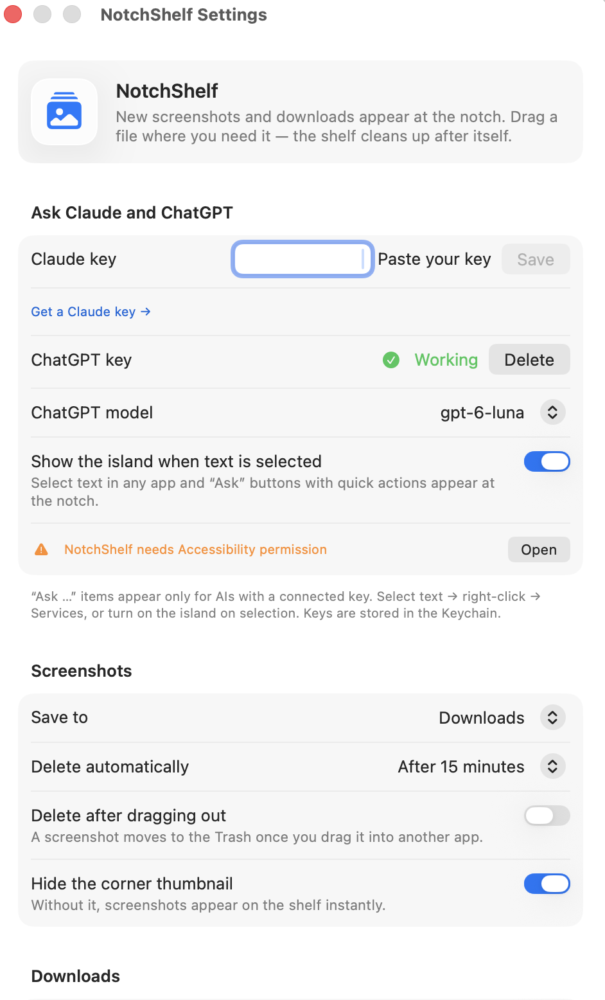
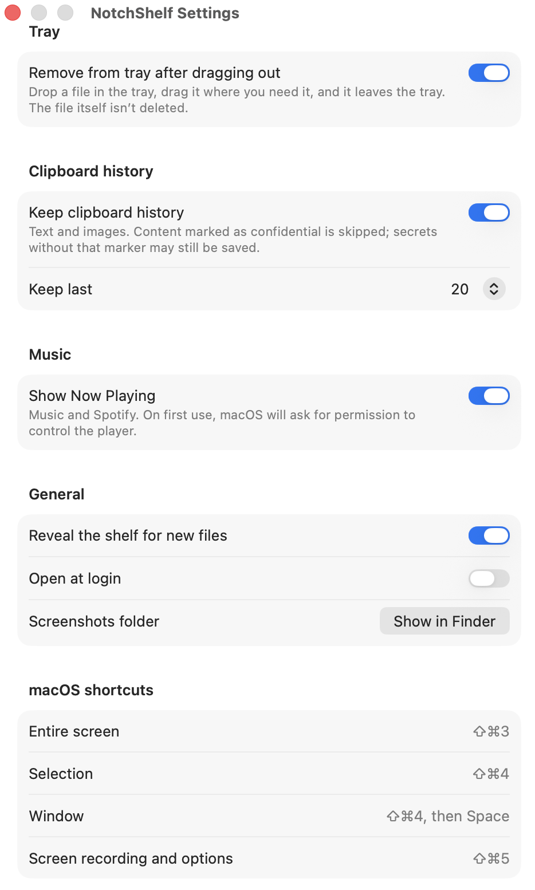
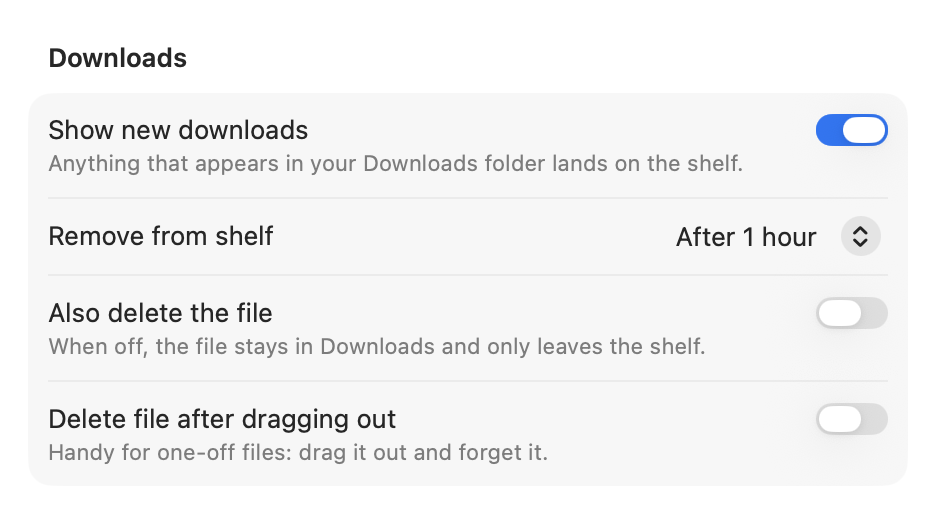

<div align="center">

# NotchShelf

**A small shelf at the top of your Mac.**

Keep screenshots, downloads, copied snippets, AI conversations, music, and a focus timer one hover away.

[](https://github.com/henadzibahdanovich/NotchShelf/actions/workflows/build.yml)
[](LICENSE)




*The real NotchShelf app, captured on macOS with the English interface. Music, a focus timer, and recent files share one shelf.*

</div>

## What is a macOS notch shelf?

NotchShelf turns the space around your MacBook's camera notch into a temporary shelf for things you use throughout the day. Hover near the notch to open a panel, pick up a recent file, drop something into the tray, or copy an earlier clipboard entry. On a display without a notch, the code provides a small pill at the top center instead.

It runs as a menu bar app, without a Dock icon. The shelf is a working area for recent items; file cleanup behavior depends on the item type and your settings.

## Features

| Feature | Implemented behavior |
| --- | --- |
| **Screenshots and downloads** | Watches the configured screenshot folder and Downloads, shows thumbnails, and lets you drag files into other apps. Screenshot actions include copying, pinning, opening, and local text recognition through Apple Vision. |
| **Music and Spotify** | Track title, artist, artwork, previous/next, and play/pause. AppleScript provides the Music/Spotify fallback; an optional private MediaRemote bridge attempts system-wide playback access. |
| **Download progress** | A ring near the notch and a card in the panel. Uses system-published file progress when available; recognized temporary download files show an indeterminate indicator otherwise. |
| **Focus timer** | 5, 15, 25, and 50 minute presets, pause/resume, add five minutes, and stop. Completion plays a sound and reveals the shelf. |
| **Clipboard history** | Text and images, click to copy, drag out, pin, and delete. Keeps 50 unpinned entries by default; settings offer 20/50/100/200. Pinned entries do not count toward that limit. |
| **Ask Claude / ChatGPT** | Select text in any app → right-click → Services → *Ask Claude* / *Ask ChatGPT* (localized). A Liquid Glass panel opens under the notch with the selection attached, quick actions (reply, translate, fix, shorten, explain), streaming answers, follow-ups, copy, and "continue in browser". Also available from the shelf header and menu bar. Attach images, PDFs, and text files by dragging them onto the panel, with the paperclip button, or with the ✨ button on a shelf card (images are downscaled to 1568 px before upload). Only providers with a saved key are shown. Optional: an island with *Ask* buttons appears automatically when you select text (requires Accessibility permission; off by default). Uses your own Anthropic / OpenAI API key. |
| **Drag-and-drop tray** | Accepts files, URLs, images, and text. Existing files stay in place and are referenced by the tray; dropped text, links, and images are saved in the app's local support folder. |

The collapsed indicator prioritizes **downloads → timer → playing music → recent files**.

## In the app

### Ask without leaving the shelf

Select text and choose **Services → Ask Claude / Ask ChatGPT**, or open a conversation from the shelf. Ask a question, attach a file, or use a quick action, then continue with follow-up questions in the same panel. Only providers with a saved API key are shown.



*An actual ChatGPT response inside NotchShelf. The paperclip adds attachments; the input below the answer continues the conversation.*

### Now Playing at a glance

<p align="center">
  
</p>

*Album artwork and playback activity stay beside the notch while the shelf is collapsed.*

<details>
<summary><strong>Explore the settings</strong> — AI, screenshots, downloads, clipboard, and more</summary>

These screenshots show the configuration used when they were captured. Cleanup times, clipboard limits, enabled features, and model choices are configurable and may differ from the defaults documented below.

<table>
  <tr>
    <th>AI and screenshots</th>
    <th>Tray, clipboard, and general settings</th>
  </tr>
  <tr>
    <td valign="top" width="50%"><a href="docs/images/settings-ai.png"></a></td>
    <td valign="top" width="50%"><a href="docs/images/settings-general.png"></a></td>
  </tr>
</table>

<p align="center">
  <a href="docs/images/settings-downloads.png"></a>
</p>

*The AI settings capture shows an Accessibility permission notice for the optional selection island. No API key values are visible. Click an image to view it at full size.*

</details>

## Project status

This is an early personal utility, published with its source code. It is not a validated production release.

- **At initial publication, local release compilation passed on November 12, 2026:** Apple Silicon (`arm64`), macOS 26.6.2, Apple Swift 6.3.3.
- The previously reported actor-isolation error in `ClipboardHistory.swift` did not recur in that build. The directory accessor is declared `nonisolated` in this source.
- At initial publication, local `--build-only` packaging, app metadata validation, and ad-hoc signature verification also passed. The badge above reports GitHub Actions status, not runtime compatibility.
- Music/Spotify automation, clipboard capture, drag-and-drop, download reporting, login items, and multi-display behavior have **not been verified end to end** as part of publication.
- There is no automated runtime test suite, signed/notarized release, or prebuilt download in this initial publication. Intel and older supported macOS versions remain unverified.

## Requirements

- macOS **14 or newer**, as declared by the package and app bundle.
- Apple's Command Line Tools or Xcode with a compatible Swift compiler and macOS SDK. `Package.swift` uses Swift tools version 5.9. The verified toolchain is listed above; the minimum toolchain has not been independently tested.
- A notch is optional. The shelf chooses one screen, preferring a notched display.
- Liquid Glass is used when compiled with Swift 6.2+ and a macOS 26 SDK, and run on macOS 26+. Earlier systems/toolchains use the material fallback in the source.

No third-party Swift packages, account, or backend are required. An Anthropic and/or OpenAI API key is needed **only** for the optional Ask Claude / ChatGPT feature.

## Install from source

1. If developer tools are not installed, run `xcode-select --install` and finish the installation.
2. Clone and build:

   ```bash
   git clone https://github.com/henadzibahdanovich/NotchShelf.git
   cd NotchShelf
   ./install.sh
   ```

The script builds for your Mac's current architecture, packages `build/NotchShelf.app`, applies a local ad-hoc signature, installs it in `/Applications`, and launches it. If replacing an existing app, it keeps a backup under `build/previous-install.*`. Do not run the script with `sudo`; if `/Applications` is not writable, move the built app there with Finder.

To compile and package **without installing or launching**:

```bash
./install.sh --build-only
```

For compilation alone:

```bash
swift build -c release
```

Ad-hoc signing is not Developer ID signing or Apple notarization. The installer does not remove quarantine attributes or disable Gatekeeper. If macOS blocks a downloaded build, review the source and use the normal macOS security controls; no security-bypass command is included.

If signing reports “resource fork, Finder information, or similar detritus not allowed” in an iCloud or other synced folder, move the checkout to a local folder outside that service and rebuild. Publication validation passed from a clean local checkout; the synced Documents folder added metadata during packaging.

## First launch, permissions, and cleanup

**Review Settings before using the shelf with files you want to keep.** These are the current defaults in the source:

| Setting or action | Current behavior |
| --- | --- |
| Screenshot location | The initial migration sets the system screenshot folder to **Downloads** and saves the previous location for uninstall. Settings also offer Desktop or `~/Pictures/NotchShelf`. |
| System screenshot thumbnail | Disabled on first launch to make files appear sooner. This changes the macOS screenshot setting, not just NotchShelf. |
| Screenshot expiration | Unpinned screenshots are sent to the **Trash after 60 minutes** by default. Select Never to disable expiry. |
| Screenshot drag-out | After an accepted drag, unpinned screenshots are sent to the Trash after a 15-second delay by default. This is a separate setting from expiration. |
| Clearing the shelf | Unpinned screenshots go to the Trash. Downloads are removed from the shelf unless their delete setting is enabled. App-created tray files are deleted when dismissed. |
| Downloads | Removed from the shelf after 24 hours by default; original downloaded files stay on disk. Optional settings can send them to the Trash. |
| Tray | Original dropped files are not moved. App-created text/link/image files are deleted on dismissal, or 15 seconds after accepted drag-out when that option is enabled. |
| Clipboard | History is enabled by default and stored locally. Turning it off stops new capture; it does not erase existing entries. |

macOS may request **Files and Folders** access for watched folders and **Automation** access to control Music or Spotify. Grant access only to features you want to use. You can review these in System Settings → Privacy & Security. Launch at login is optional and uses the system login-item service.

The app watches screenshots saved by macOS; it does not implement its own screen recording. The source does not request broad Full Disk Access. **Accessibility** access is requested only if you turn on *Show island on text selection*; it is used to read the selected text in the focused app (password fields are skipped). Because local builds are ad-hoc signed, you may need to re-enable NotchShelf in Accessibility after each rebuild. Music integration depends on the running player's permissions.

## Privacy and local storage

- Clipboard text and metadata are stored as JSON, and clipboard images as PNGs, under `~/Library/Application Support/NotchShelf/Clips/`. These files are **not encrypted by the app**.
- Dropped text, links, and images are stored under `~/Library/Application Support/NotchShelf/Tray/`. Shelf references and settings are kept in UserDefaults.
- Known concealed/transient pasteboard markers are skipped. **This is not a guarantee that all passwords or secrets are excluded**: unmarked sensitive text can be captured. Pause history before copying sensitive content and remove saved entries as needed.
- **Ask Claude / ChatGPT sends data to a third party.** When you send a question, the question, the selected text, any attached files, and the conversation are sent to Anthropic (`api.anthropic.com`) or OpenAI (`api.openai.com`) under your API key and their terms. Nothing is sent until you press Send or a quick action. API keys are stored in the macOS Keychain (service `app.glamlabs.notchshelf`); conversations are not saved to disk.
- The reviewed source contains no analytics or cloud-sync implementation. Spotify artwork can be fetched over the network from the artwork URL returned by Spotify.
- `docs/images/` contains reviewed screenshots of the app. Runtime clipboard databases, API keys, `.env` files, certificates, developer caches, and compiled app bundles are not included.

## Limitations

- The interface is localized into 10 languages: English, Russian, Simplified Chinese, Spanish, Hindi, Arabic, French, Portuguese (Brazil), Japanese and German. The language follows macOS settings (System Settings → General → Language & Region; per-app language can be set there too). Translations were prepared without native-speaker review.
- Browser playback, including YouTube, is not guaranteed. MediaRemote is a private framework and may be unavailable or change without notice. Music and Spotify use the explicit AppleScript fallback.
- Percentage progress depends on what the browser or downloader publishes to macOS. Temporary-file detection is heuristic; not every download is visible.
- Watching is limited to configured top-level folders. Existing untracked files are not imported automatically, and screenshot identification relies on macOS metadata.
- The timer is in memory and is not restored after quitting. It is not a system alarm service.
- The shelf currently targets one display. Full-screen, multi-monitor, notchless, and Intel behavior need further testing.
- There is no custom global keyboard shortcut (assign one to the Services items in System Settings → Keyboard → Keyboard Shortcuts → Services), cloud upload, image conversion, or GIF generation in this source.
- Ask Claude / ChatGPT: the Services items may need a log out/in or enabling in Keyboard Shortcuts → Services before they appear. Answers render inline Markdown only (no tables or headings). Model lists are fetched from each provider; the defaults are `claude-sonnet-4-5` and `gpt-5` until a key is validated. Because local builds are ad-hoc signed, macOS may ask to allow Keychain access again after a rebuild.

## Uninstall

Disable “Open at login” in Settings if enabled, quit NotchShelf, then run:

```bash
./uninstall.sh
```

The script removes the installed app, restores the saved screenshot location if one is available, re-enables the system screenshot thumbnail, and deletes the app's preferences. It leaves clipboard/tray data and screenshot files on disk. After quitting, you can remove `~/Library/Application Support/NotchShelf/` yourself if you want to erase that local history. Review any tray files you want to keep first.

The original bundle identifier, `app.glamlabs.notchshelf`, is retained for compatibility with existing preferences and permissions. The repository is maintained under the personal account linked above.

## Development and contributions

The project uses Swift Package Manager with AppKit, SwiftUI, Vision, and Quick Look. Open `Package.swift` in Xcode or build from the command line.

- `Sources/NotchShelf/`: app lifecycle, shelf UI, AI conversations and attachments, filesystem monitoring, clipboard, playback, timer, and localization.
- `Resources/AppIcon.icns`: the supplied app icon.
- `install.sh` / `uninstall.sh`: local packaging and installation lifecycle.
- `docs/images/`: real app screenshots of the shelf, AI conversation, collapsed player, and settings.

See [CONTRIBUTING.md](CONTRIBUTING.md) for validation and issue-reporting guidance. Please keep personal files and clipboard contents out of issues and pull requests.

## License

[MIT](LICENSE) · Copyright (c) 2026 Henadzi Bahdanovich.
